# ParaPo! 🚌

**Know your fare before you say "Para po!"**

ParaPo is a jeepney and UV Express fare calculator and trip log for Filipino commuters. Pick
where you're going on a map, get the official fare with your student/senior/PWD discount
applied, and keep a log of what you spend. Admins publish fare-matrix updates, and every
user is notified in-app and by browser push notification.

Built for the Full Stack Developer tech exam with **Next.js 15 · NestJS 11 · PostgreSQL 16
(Prisma) · Docker Compose**.

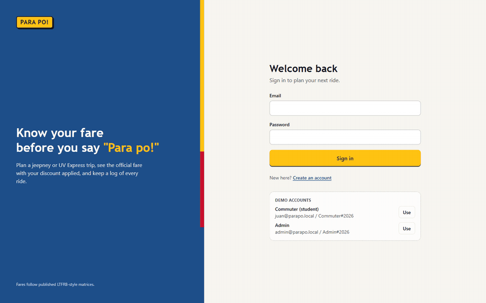

<sub>40-second phone walkthrough · [higher-quality MP4](Docs/parapo-demo.mp4) · full screenshots below</sub>

---

## Quick start (one command)

**Prerequisites:** [Docker Desktop](https://www.docker.com/products/docker-desktop/) (or Docker
Engine + Compose v2) and an internet connection (for map tiles, place search and routing).

```bash
git clone https://github.com/13urning/parapo.git
cd parapo
docker compose up --build
```

Open **http://localhost:3000**. The first build takes a few minutes. Migrations and seed data
run automatically, and no `.env` files or secrets are needed.

### Demo accounts

| Role | Email | Password |
|---|---|---|
| Commuter (student, 20% discount) | `juan@parapo.local` | `Commuter#2026` |
| Admin | `admin@parapo.local` | `Admin#2026` |

The login page also has one-click "Use" buttons for both. These accounts exist only in your
local database.

To stop the app: `docker compose down`. To also wipe the database: `docker compose down -v`.

---

## What you can do

### Login (`/login`, `/register`)
Email/password sign-in, or create an account and pick your fare category (Regular, Student,
Senior, PWD).

### Workflow 1: Commuter plans and logs a trip
1. **Plan a trip** (`/plan`): search an origin and destination (OpenStreetMap Nominatim), see
   the road route on the map (OSRM), choose Traditional jeepney, Modern jeepney or UV Express,
   and get a fare quote that shows the regular fare against your discounted fare.
2. **Save trip**: the server recomputes the fare from the published matrix (the client's
   number is never trusted) and stores it.
3. **My trips** (`/trips`): paginated history with "spent this month" and trip-count stats.
   Delete a trip with confirmation.
4. **Fares** (`/fares`): the published fare tables for 1–20 km per vehicle type.

If the routing service is unreachable, the API falls back to a straight-line × 1.3 estimate
and the UI marks the distance **Estimated**.

### Workflow 2: Admin publishes a fare update
1. **Fare matrices** (`/admin/fare-matrices`): matrices by vehicle type with Draft / Published /
   Archived status.
2. **New / edit draft** (`/admin/fare-matrices/new`, `/admin/fare-matrices/[id]`): base fare,
   base km, per-km rate, discount % and effective date, all validated on both client and server.
3. **Publish**: archives the current matrix for that vehicle type, publishes the draft (the
   database enforces one published matrix per vehicle type) and notifies every user.
4. **Analytics** (`/admin/analytics`): page views by page and by day for the last 14 days.

### Notifications
- The bell in the header shows unread in-app notifications (`/notifications` lists them and
  marks them read).
- **Push notifications:** click *Enable push notifications* on the notifications page, then
  publish a fare update as admin and the browser shows a system notification. VAPID keys are
  generated automatically on first start. Push works on `localhost` in Chrome, Edge and Firefox.

---

## Screenshots

### Commuter

| Login | Plan a trip: search |
|---|---|
| 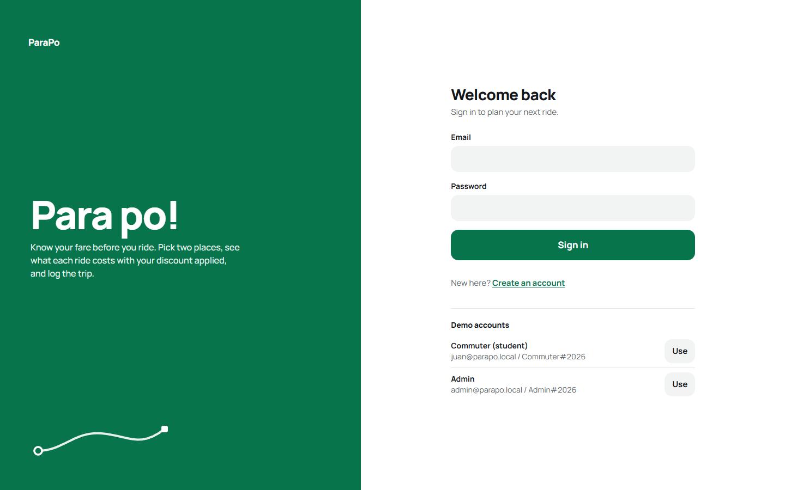 | 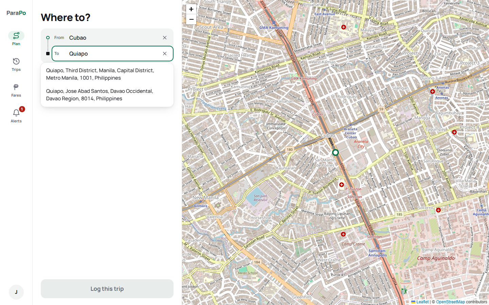 |
| **Fare quote with route and student discount** | **My trips** |
| 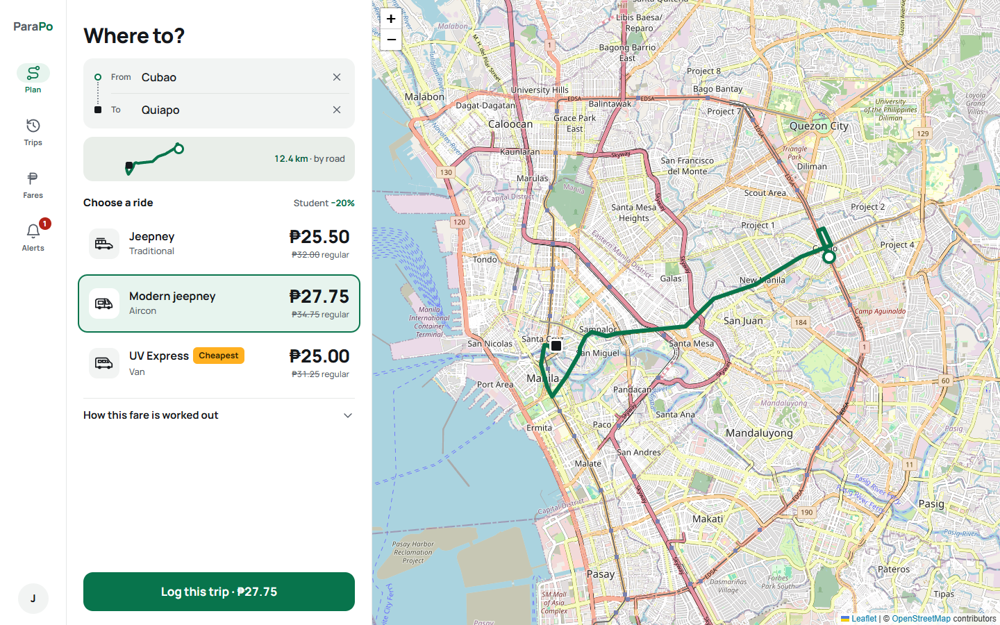 | 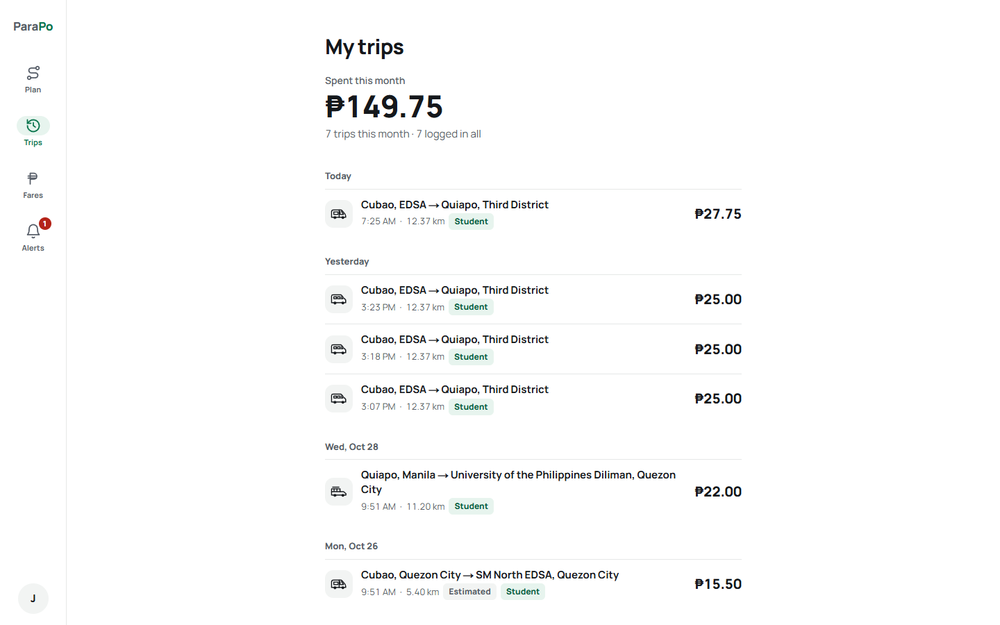 |
| **Fares: try a distance per vehicle** | **Notification after a fare update** |
| 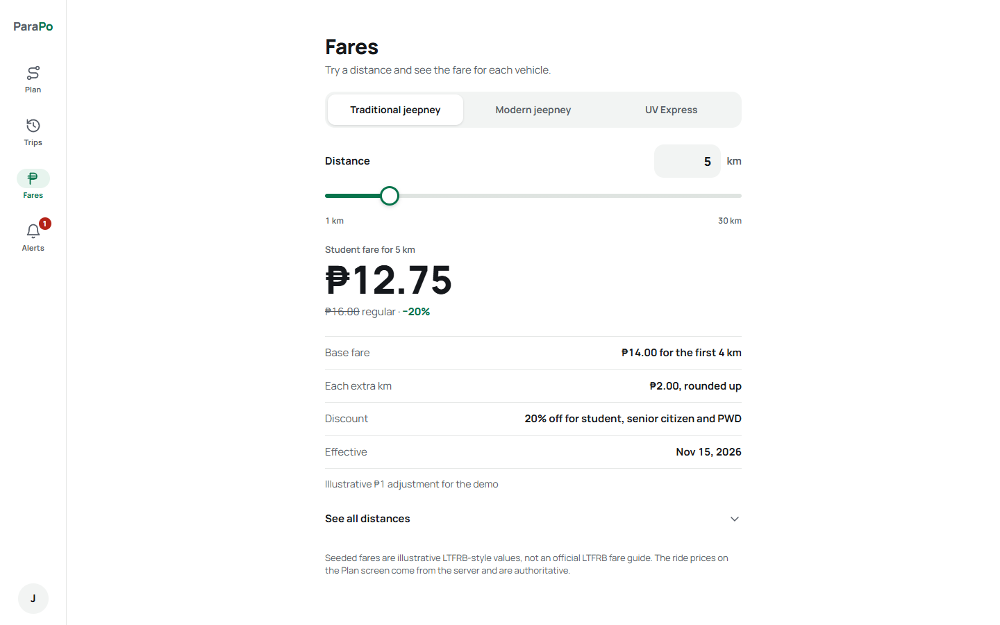 | 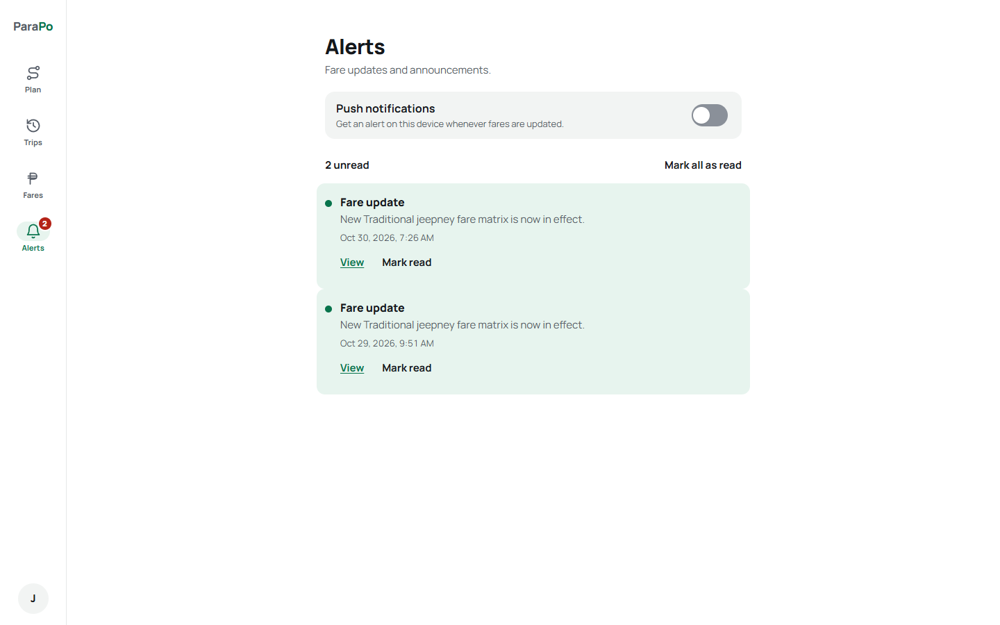 |

### Admin

| Fare matrices | New draft |
|---|---|
| 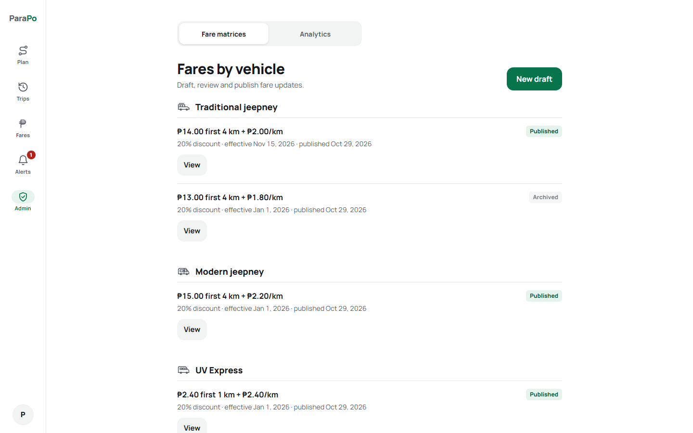 | 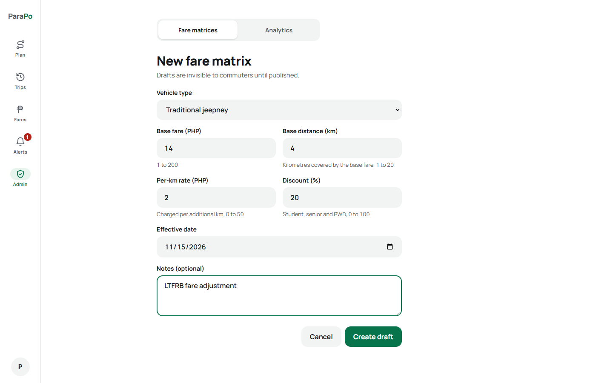 |
| **Publish confirmation** | **Published: previous matrix archived** |
| 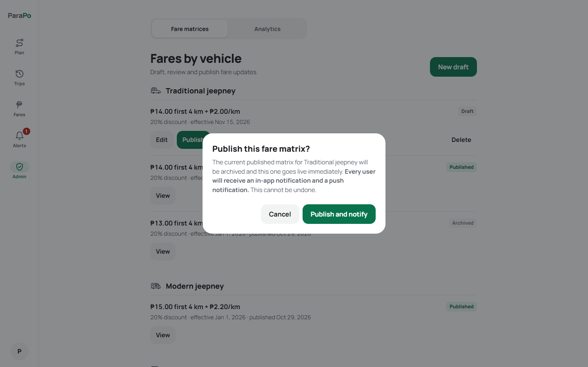 | 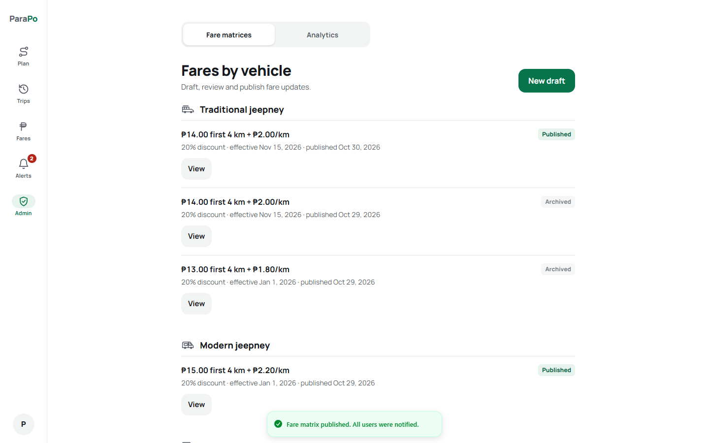 |
| **Page analytics** | **Mobile** |
| 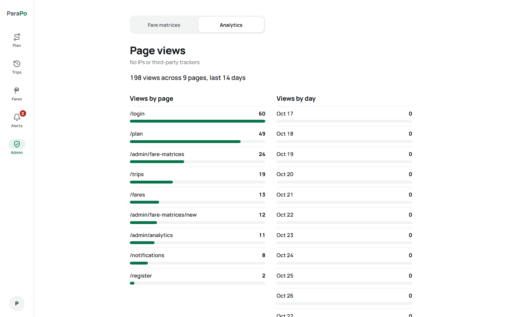 | 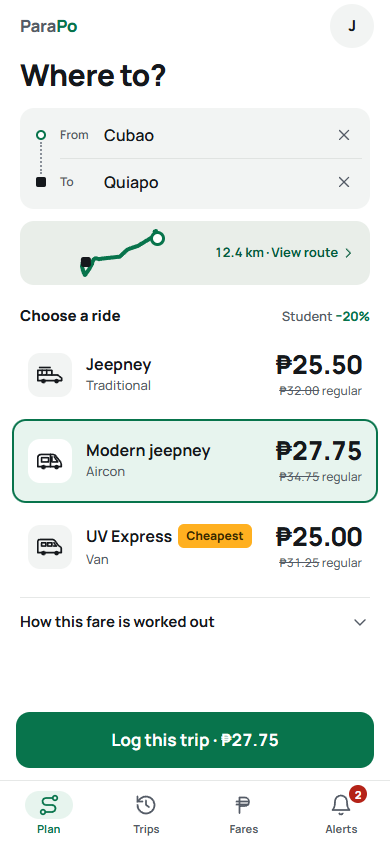 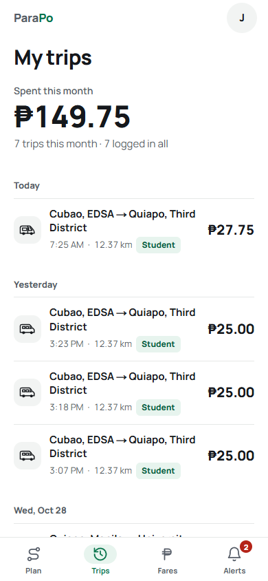 |

---

## Architecture

```
Browser ──► web (Next.js :3000) ──/api/v1/* proxy──► api (NestJS :3001) ──► db (Postgres :5432)
             App Router UI                            REST /api/v1           Prisma
             route handler proxy                      JWT cookie auth
                                                      ├─► Nominatim (geocoding)
                                                      ├─► OSRM (routing)
                                                      └─► Web Push services
```

- **Same-origin design:** the browser only talks to the web app. A Next.js route handler
  (`apps/web/app/api/v1/[...path]/route.ts`) forwards `/api/v1/*` to the API over the internal
  Docker network. The session cookie therefore stays first-party (`httpOnly`, `SameSite=Lax`)
  and no CORS is needed. Only port 3000 is published; the API and database are not exposed.
- **Auth:** the API issues a signed JWT in an `httpOnly` cookie. Next middleware only uses the
  cookie for UX redirects; the API enforces authentication, roles and ownership on every
  request.
- **Secrets:** `JWT_SECRET` and the VAPID keys can be set by environment variable. Otherwise
  they are generated once and stored in the database, which is why the app runs out of the box.

### Project structure

```
apps/
  api/                    NestJS API
    prisma/               schema, migrations, seed
    src/
      auth/  users/       login, register, JWT cookie, guards, @Roles, @CurrentUser
      places/             Nominatim + OSRM proxy (timeouts, cache, fallback)
      fares/              fare-calculator.ts (pure) + quote endpoint
      trips/              owner-scoped trip log
      fare-matrices/      draft → publish workflow
      notifications/      in-app notifications + Web Push
      analytics/          page views + summary
      config/ common/     fail-closed config, secrets bootstrap, request guard
  web/                    Next.js App Router
    app/(public)/         /login, /register
    app/(app)/            /plan, /trips, /fares, /notifications, /admin/*
    app/api/v1/[...path] same-origin API proxy
    components/ui/        reusable primitives (Button, Card, Modal, Pagination, ...)
    features/<feature>/   feature components + React Query hooks
    lib/api/              typed API client
    providers/            React Query + session providers
    middleware.ts         route guards
Docs/                     acceptance criteria, API contract
```

**State management:** TanStack Query handles server state (a query-key factory, with
invalidation after mutations), a React context holds the session, and React Hook Form + Zod
manage form state.

### Fare formula

```
extraKm  = max(0, ceil(distanceKm − baseKm))
regular  = baseFare + extraKm × perKmRate
fare     = regular × (1 − discount%)   for Student / Senior / PWD
rounded to the nearest ₱0.25
```

Seeded matrices are illustrative LTFRB-style values (e.g. Traditional jeepney ₱13.00 for the
first 4 km + ₱1.80/km). They are not an official fare guide, and admins can change them.

---

## Running tests and checks

Requires Node.js 22+.

```bash
cd apps/api && npm ci && npx prisma generate && npm run lint && npm test -- --coverage && npm run build
cd apps/web && npm ci && npm run lint && npm run typecheck && npm test -- --coverage && npm run build
```

- **API (Jest):** the fare calculator, auth (incl. no user enumeration), trips (server-side fare,
  ownership), fare-matrix publishing, places fallback, notifications and push, the secrets
  bootstrap, guards and analytics. No database is needed; Prisma is mocked.
- **Web (Vitest + Testing Library):** the API proxy (cookies, headers, timeouts), middleware
  guards, forms, fare quote card, trip history, notifications, pagination, dialogs and the page
  view tracker.

GitHub Actions (`.github/workflows/ci.yml`) runs lint, typecheck, tests and build for both
apps, then boots the full stack with `docker compose up --wait` and checks the health endpoint.

## Local development without Docker (optional)

```bash
# Postgres must be running locally; copy apps/api/.env.example to apps/api/.env and set DATABASE_URL
cd apps/api && npm install && npx prisma generate && npm run build && npx prisma migrate deploy && npm run seed && npm run start:dev
cd apps/web && npm install && npm run dev      # API_INTERNAL_URL defaults to http://localhost:3001
```

## Security and privacy notes

- bcrypt password hashing (cost 12) and a generic login error with comparable timing (no
  account enumeration).
- 24-hour sessions; logout revokes the token server-side.
- Rate limits on login and register: per account, plus a cap across all clients.
- Helmet security headers on the API, and an enforced nonce-based Content Security Policy on
  the web app.
- Safe post-login redirects (same-origin paths only).
- Push subscriptions are restricted to known browser push services, with at most 5 per user.
- Server-side validation with whitelisting, owner-scoped queries (no IDOR), and an Origin check
  plus JSON-only bodies on writes.
- Privacy (RA 10173): only the minimum personal data is collected, users can delete their trips,
  and page analytics store no IP address, user agent or query string.
- The Postgres password in `docker-compose.yml` is a local-only development value. The database
  and API ports are not published, and the web port is bound to `127.0.0.1`.
- Demo accounts are seeded only when `SEED_DEMO_DATA=true` (set in `docker-compose.yml` for the
  local demo).
- Behind a trusted reverse proxy, set `TRUST_PROXY_HEADERS=true` on the web service so per-IP
  limits use the real client IP.

## Nice-to-haves included

- ✅ Dockerized (one-command `docker compose up`)
- ✅ Push notifications (Web Push + service worker, VAPID)
- ✅ Page analytics (self-hosted, privacy-preserving, with an admin dashboard)

## Credits

Map data © [OpenStreetMap](https://www.openstreetmap.org/copyright) contributors. Geocoding by
Nominatim, routing by [OSRM](https://project-osrm.org/).
